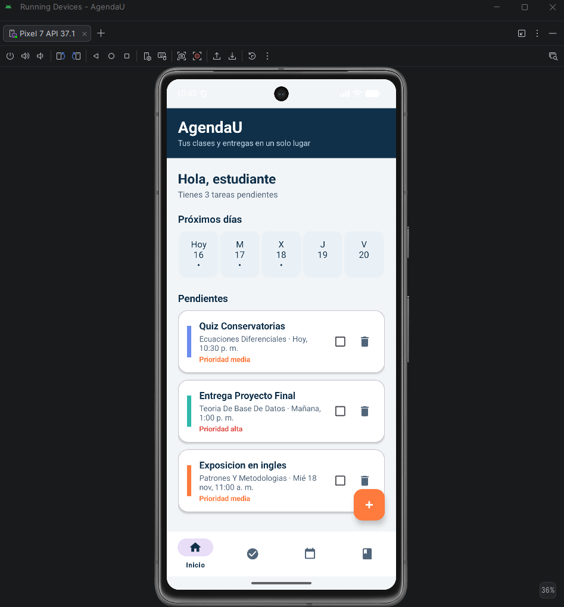
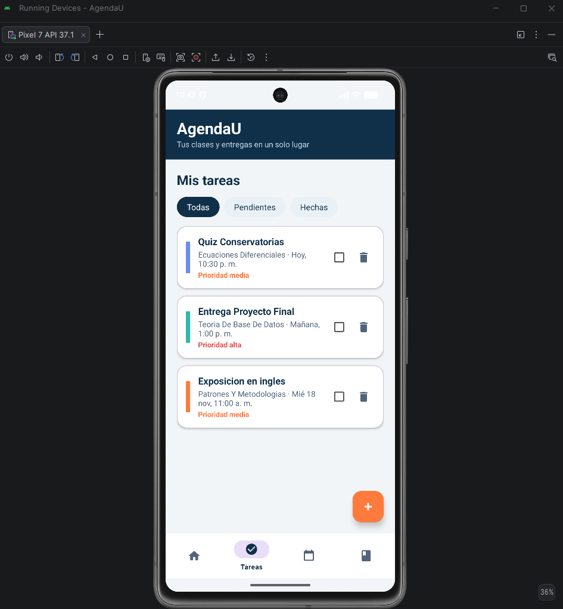
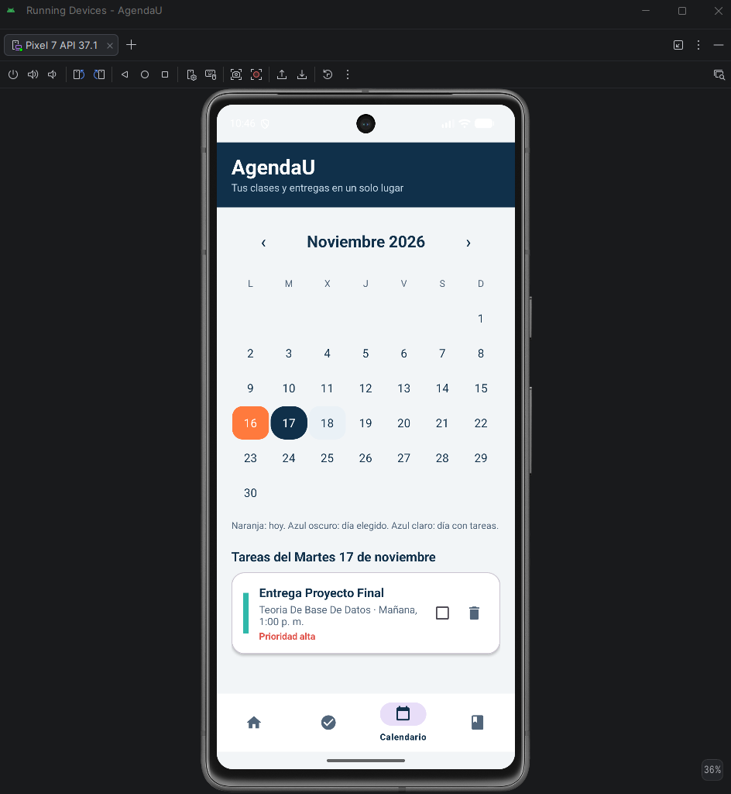
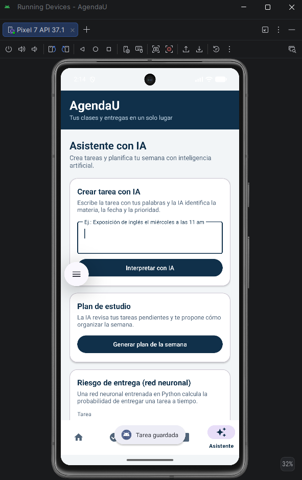
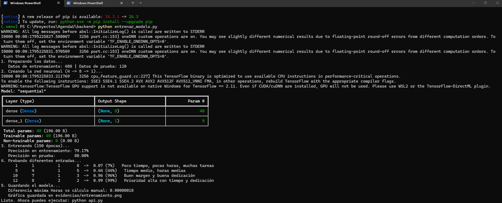
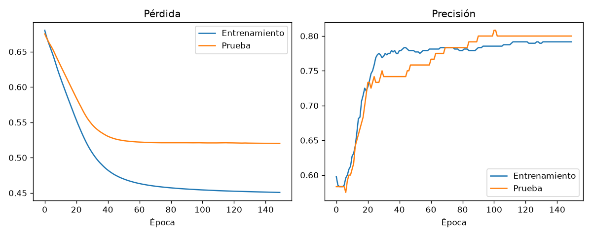
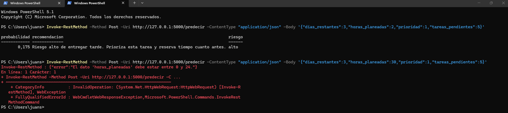
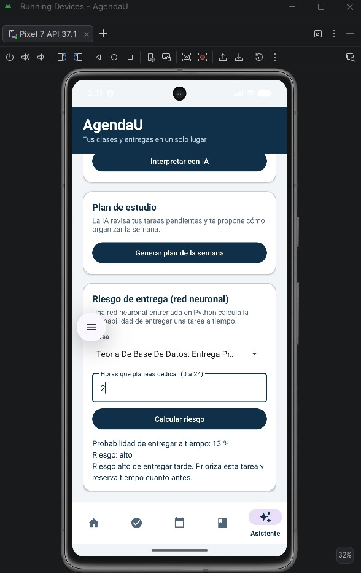

# AgendaU

AgendaU es una aplicación móvil para Android que ayuda a los estudiantes universitarios a organizar sus materias, tareas y fechas de entrega en un solo lugar. Este proyecto se desarrolla en la asignatura Taller de Programación e integra un servicio de Inteligencia Artificial y una red neuronal propia.

## Problema que atiende

Durante el semestre, la información de las entregas suele quedar repartida entre grupos de mensajería, la plataforma de la universidad y los cuadernos personales. Esto hace que sea fácil olvidar una actividad o no saber qué está pendiente. AgendaU reúne esa información, la organiza y usa inteligencia artificial para ayudar a planificar y a anticipar los riesgos de entrega.

## Funcionalidades

- **Materias:** se crean con nombre, horario y color. Muestran cuántas tareas tienen pendientes y se pueden eliminar junto con sus tareas.
- **Tareas:** se crean con título, materia, fecha, hora y prioridad. Se pueden marcar como hechas, filtrar y eliminar.
- **Inicio y Calendario:** muestran las tareas pendientes por día y por mes.
- **Asistente con IA (Gemini):** crea tareas a partir de un texto escrito con palabras normales y genera un plan de estudio para la semana.
- **Riesgo de entrega (red neuronal):** calcula la probabilidad de entregar una tarea a tiempo.

### Pantallas de la aplicación







## Arquitectura de la solución

```
Usuario -> Interfaz (Android) -> Lógica de la app -> ClienteIa -> API de Gemini -> Respuesta -> Interfaz
Usuario -> Interfaz (Android) -> ClienteRedNeuronal -> API Flask (Python) -> Red neuronal -> Predicción -> Interfaz
```

## Servicio de IA utilizado

Se usa la **API de Gemini de Google** (Google AI Studio), mediante el método `generateContent` de su API REST. Se eligió porque tiene un nivel gratuito para uso académico y se puede conectar con peticiones HTTP, sin librerías adicionales. El modelo se configura con la variable `GEMINI_MODEL` en el archivo `local.properties`.

### Cómo funciona la integración

1. **Conexión:** la app envía una petición HTTP (POST) al servicio, con la clave de la API en el encabezado `x-goog-api-key`. El código está en `ia/ClienteIa.kt`.
2. **Envío de información:** se manda una instrucción y el texto del estudiante. Para crear tareas se incluyen la fecha de hoy y los nombres de sus materias, y para el plan se envían las tareas pendientes.
3. **Procesamiento:** para crear tareas se pide una respuesta en formato JSON, que la app lee y comprueba. Para el plan se limpia el texto recibido.
4. **Presentación:** el resultado se muestra en la pantalla Asistente. En el caso de las tareas, el estudiante confirma antes de guardar.
5. **Integración real:** la tarea creada con IA se guarda en la misma base de datos SQLite y pasa por las mismas validaciones que una tarea creada a mano.

### Evidencias de la IA





## Red neuronal

AgendaU incluye una red neuronal desarrollada en Python con TensorFlow y Keras, que estima la **probabilidad de entregar una tarea a tiempo**.

- **Entradas (4):** días restantes para la entrega, horas que el estudiante planea dedicar, prioridad de la tarea y número de tareas pendientes.
- **Salida:** probabilidad entre 0 y 1 de entregar a tiempo.
- **Arquitectura:** 4 entradas, una capa oculta de 8 neuronas con ReLU y una neurona de salida con Sigmoid.
- **Entrenamiento:** 150 épocas con el optimizador Adam y la pérdida `binary_crossentropy`.
- **Datos:** 600 registros simulados (480 para entrenar y 120 para probar), porque AgendaU todavía no tiene un historial real de entregas. Son datos didácticos y se pueden reemplazar por datos reales.
- **Resultados:** precisión de 79,17 % en entrenamiento y 80 % en prueba.

Ejemplos de predicción:

| Días | Horas | Prioridad | Tareas | Probabilidad de entregar a tiempo |
|---|---|---|---|---|
| 1 | 1 | 1 | 8 | 7 % |
| 5 | 4 | 1 | 5 | 44 % |
| 10 | 7 | 1 | 3 | 96 % |
| 12 | 8 | 2 | 2 | 99 % |

### Integración con la aplicación

La red se expone con una API en Flask (`backend/api.py`). La app Android envía los datos de la tarea por HTTP en formato JSON, y la API responde con la probabilidad, el nivel de riesgo y una recomendación. En el emulador la API se alcanza en `http://10.0.2.2:5000`.

### Evidencias de la red neuronal






## Validaciones y manejo de errores

- El título de la tarea es obligatorio (3 a 60 caracteres) y la fecha no puede ser anterior a hoy. Estas reglas también se aplican a lo que devuelve la IA.
- No se puede usar el asistente sin materias creadas.
- Las horas para el cálculo de riesgo deben estar entre 0 y 24.
- Si el servicio de IA falla, la app muestra un mensaje claro y no se cierra. Se manejan estos casos: sin internet, tiempo de espera agotado, clave inválida, límite de uso, modelo no encontrado, servicio no disponible (con reintentos automáticos) y respuestas vacías o mal formadas.
- Si el servidor de la red neuronal no está en ejecución o rechaza los datos, la app informa el problema.

### Evidencias del manejo de errores


## Pruebas realizadas

| Prueba | Resultado esperado |
|---|---|
| Consulta válida a la IA | Se muestra el resumen de la tarea |
| Campo vacío o texto muy corto | La app pide una descripción más completa |
| Sin conexión a internet | Mensaje de falta de conexión |
| Clave de la API inválida | Mensaje de error de autenticación |
| Cálculo de riesgo con el servidor activo | Se muestra el porcentaje y la recomendación |
| Cálculo de riesgo con el servidor apagado | Mensaje de que no se pudo conectar |
| Horas fuera del rango permitido | Mensaje de validación |

## Organización del código

- `frontend/`: aplicación Android en `frontend/app/src/main/java/com/agendau/app/`
  - `MainActivity.kt`: navegación entre las cinco secciones.
  - `data/`: modelos y base de datos (SQLite).
  - `ia/`: conexión con Gemini y con la API de la red neuronal.
  - `ui/`: pantallas, formularios y componentes.
  - `util/`: manejo de fechas y validaciones.
- `backend/`: red neuronal y API en Python.
  - `entrenar_modelo.py`: genera los datos, entrena y guarda el modelo.
  - `api.py`: API en Flask que usa el modelo.
  - `probar_gemini.py`: script para comprobar la clave y el modelo de Gemini.
  - `datos/`, `modelo/` y `evidencias/`: datos, modelo entrenado y resultados.

## Tecnologías

- Android Studio y Kotlin
- SQLite
- API de Gemini (Google AI Studio)
- Python 3.12, TensorFlow/Keras, NumPy y Flask
- Interfaz con XML y componentes Material

## Instrucciones para ejecutar el proyecto

### Aplicación Android

1. Clonar este repositorio.
2. Obtener una clave gratuita en https://aistudio.google.com/apikey
3. Abrir la carpeta `frontend` con Android Studio y esperar la sincronización de Gradle.
4. Agregar estas líneas al final del archivo `local.properties` (este archivo no se sube al repositorio, por lo que la clave no queda expuesta):

```
GEMINI_API_KEY=tu_clave
GEMINI_MODEL=gemini-flash-latest
```

5. Sincronizar Gradle y ejecutar la app en un emulador o celular con Android 8 o superior.
6. Crear primero una materia y luego usar la pestaña Asistente.

### Red neuronal y API (Python)

1. Abrir una terminal en la carpeta `backend` y crear un entorno virtual con Python 3.12: `py -3.12 -m venv .venv`
2. Activarlo (`.venv\Scripts\activate`) e instalar las dependencias: `pip install -r requirements.txt`
3. Entrenar el modelo: `python entrenar_modelo.py`
4. Iniciar la API y dejarla abierta mientras se usa la app: `python api.py`

Para comprobar que la clave de Gemini funciona sin abrir la app, se puede ejecutar `python probar_gemini.py` dentro de `backend`.

## Historial del proyecto

- **Fase I:** repositorio e interfaz inicial.
- **Fase II:** base de datos, formularios y validaciones.
- **Fase III:** integración del servicio de IA, red neuronal en Python y versión final.

## Integrante

Juan Sebastián Jiménez