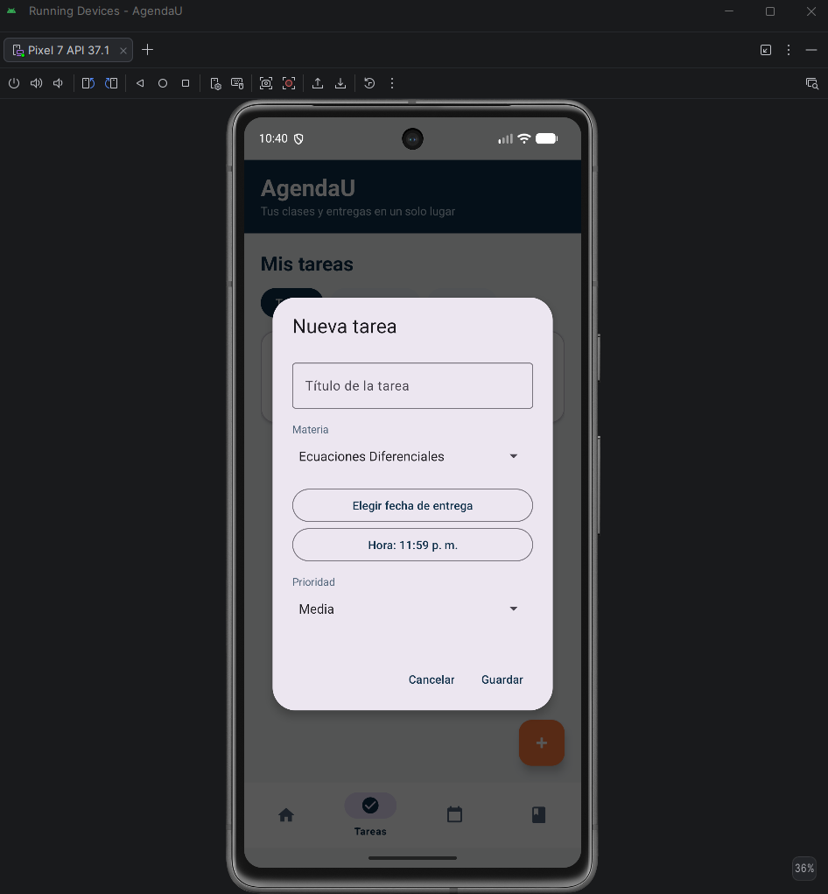
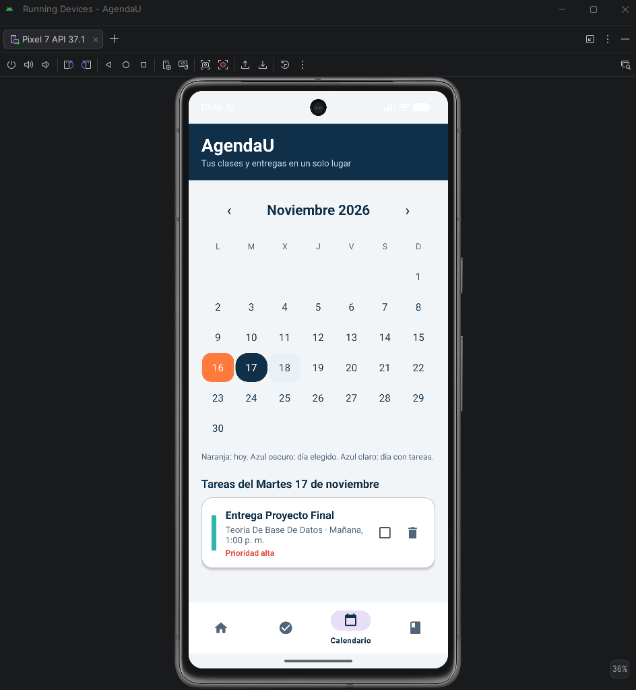
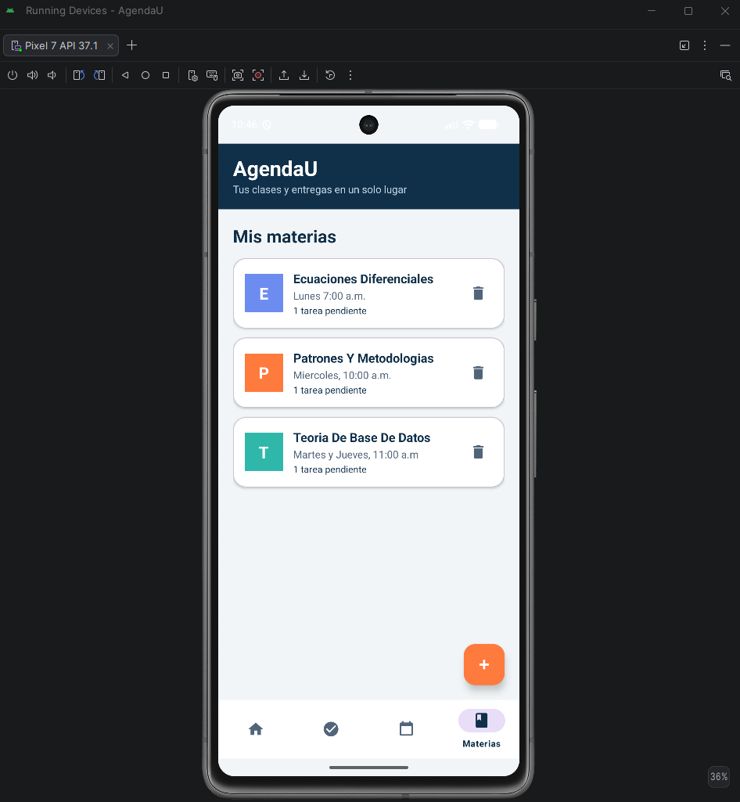

# AgendaU

AgendaU es una aplicación móvil para Android que ayuda a los estudiantes universitarios a organizar sus materias, tareas y fechas de entrega en un solo lugar. Este proyecto se desarrolla en la asignatura Taller de Programación.

## Problema que atiende

Durante el semestre, la información de las entregas suele quedar repartida entre grupos de mensajería, la plataforma de la universidad y los cuadernos personales. Esto hace que sea fácil olvidar una actividad o no saber qué está pendiente. AgendaU busca reunir esa información y mostrarla de forma clara.

## Descripción del prototipo (Fase II)

El prototipo permite registrar materias y tareas, guardarlas en una base de datos local y consultarlas en distintas pantallas. Los datos se conservan al cerrar la aplicación. La navegación se hace con un menú inferior con cuatro secciones.

## Funcionalidades

- **Materias:** se crean con nombre, horario y color. Cada materia muestra cuántas tareas tiene pendientes y se puede eliminar (también se borran sus tareas).
- **Tareas:** se crean con título, materia, fecha, hora y prioridad. Se pueden marcar como hechas, filtrar (todas, pendientes y hechas) y eliminar. Las tareas vencidas se identifican en la lista.
- **Inicio:** muestra un resumen de las tareas pendientes y los próximos cinco días. Al tocar un día se filtran las tareas de esa fecha.
- **Calendario:** presenta el mes completo, resalta el día actual y los días con tareas, y permite cambiar de mes. Al elegir un día se listan sus tareas.

## Validaciones

- El título de la tarea no puede estar vacío y debe tener entre 3 y 60 caracteres.
- La fecha de entrega es obligatoria y no puede ser anterior a hoy.
- No se puede crear una tarea si todavía no existe una materia.
- El nombre de la materia no puede estar vacío ni repetirse, y el horario es obligatorio.
- Antes de eliminar una tarea o una materia, la aplicación pide confirmación.

## Manejo de datos

La información se guarda en una base de datos local SQLite con dos tablas, `materias` y `tareas`, relacionadas por la materia. Al eliminar una materia se eliminan también sus tareas.

## Organización del código

El código fuente está en `frontend/app/src/main/java/com/agendau/app/` y se divide así:

- `MainActivity.kt`: pantalla principal y navegación entre secciones.
- `data/`: modelos y base de datos (SQLite).
- `ui/`: pantallas, formularios y componentes de la interfaz.
- `util/`: manejo de fechas y validaciones.

## Tecnologías

- Android Studio
- Kotlin
- SQLite
- Diseño de interfaz con XML y componentes Material

## Capturas

## Estado del proyecto

Esta es la Fase II del proyecto. La integración de un servicio de Inteligencia Artificial se realizará en la entrega final.

## Integrante

Juan Sebastián Jiménez